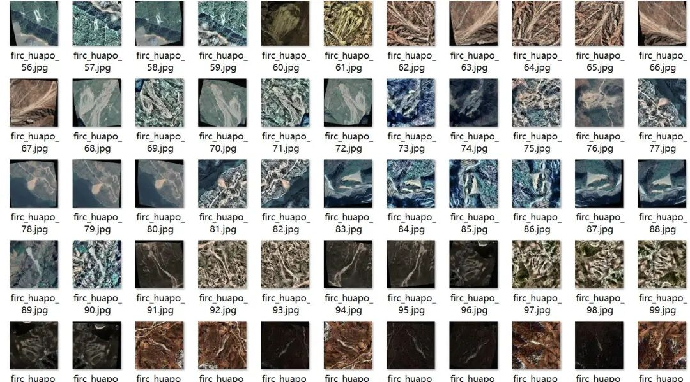
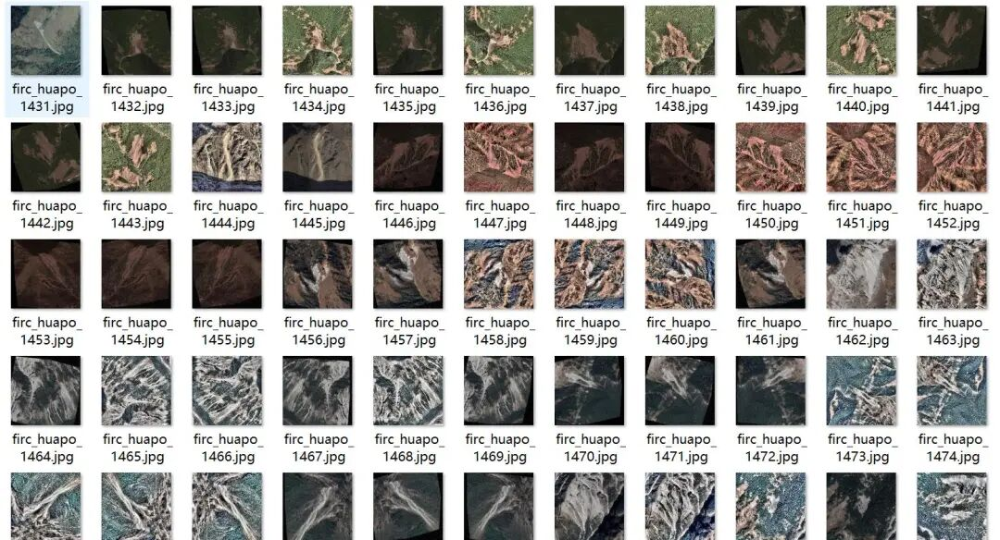
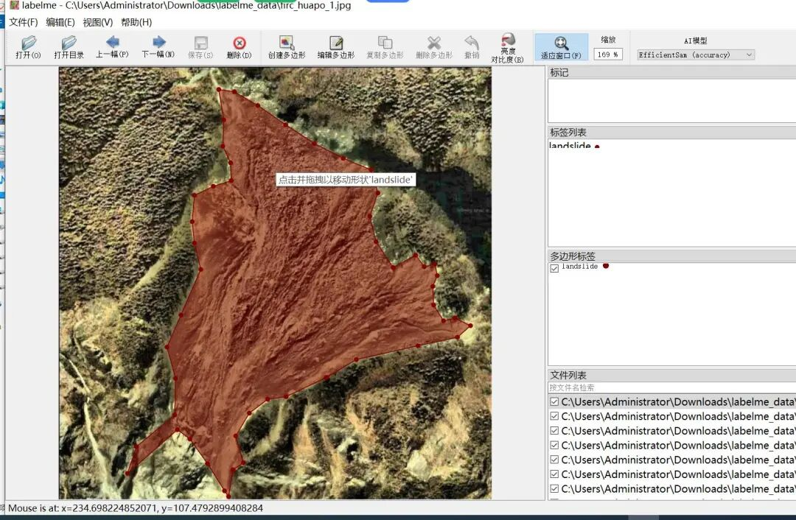
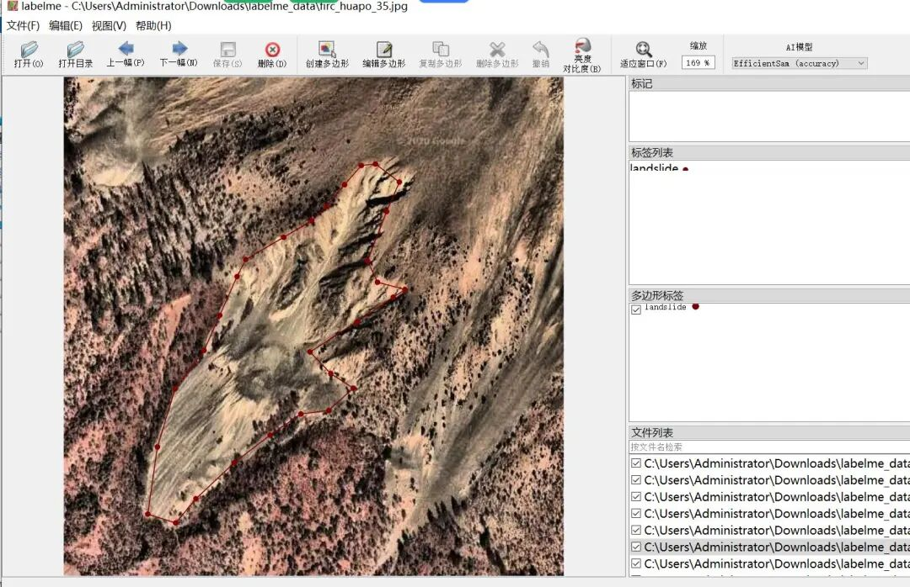

# Remote Sensing Landslide Identification and Segmentation Dataset - LabelMe format: 1893 images, 1 category

Dataset format: labelme format (without mask files, only including jpg images and corresponding json files)

Number of images (number of jpg files): 1893

Number of annotations (json file count): 1893

Label category count: 1

Label category name: ["landslide"]

Number of boxes labeled in each category:

landslide count = 2721

Using labeling tool: labelme=5.5.0

Resolution: 640x640 with 1050 images, 512x512 with 843 images

Data Augmentation: Enhanced, note that data augmentation involves rotating image rows, blurring, Gaussian blurring, adjusting brightness and contrast, adding noise, and stitching to enhance the model's ability to recognize from multiple angles. The enhanced images are not duplicates but an expansion of the dataset to improve the model's recognition capabilities. This is a normal practice and not an intentional inclusion of inauthentic content.

Annotation rules: Draw polygons around the categories.

Important Notice: The dataset can be opened and edited using LabelMe. For JSON datasets, one must convert them into mask or Yolo formats for semantic segmentation or instance segmentation.

Special : This dataset does not guarantee the accuracy or precision of the trained models or weight files. The dataset is provided with accurate and reasonable annotations only.

Image Preview:

Annotation example:

## Payment

Here is a pay link on Stripe ( https://buy.stripe.com/3cs8yP7sY87d0vu9AB ). Please contact me lonlonago@foxmail.com after funding $89, and I will send you a complete data files , thank you!

